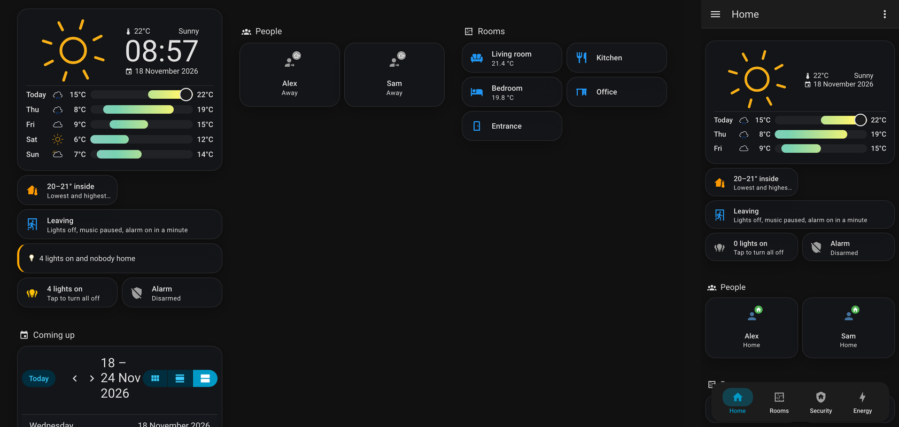
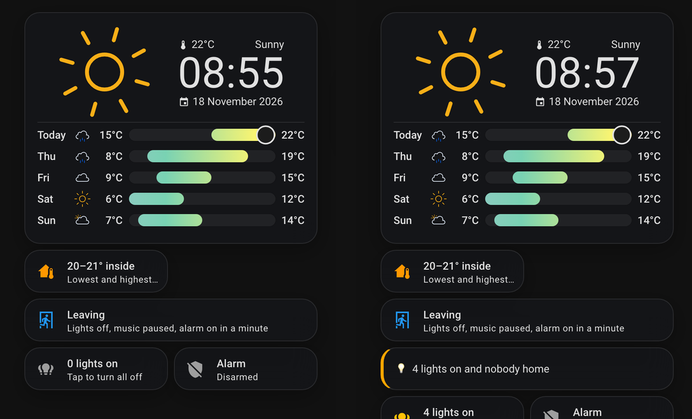
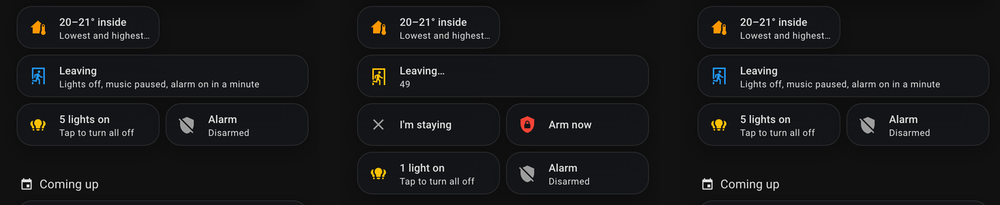
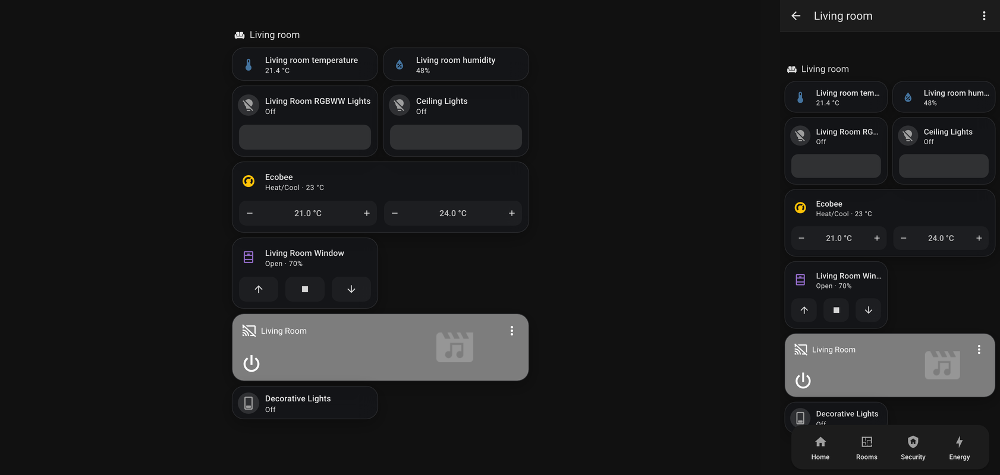

# Wall Panel Kit for Home Assistant

A **wall-tablet dashboard** and a matching **phone dashboard**, generated from one short file that lists your rooms and entities. Frosted-glass look, an "attention" strip that only shows what needs doing, one tap to every room — and on phones, a floating bottom tab bar with **no kiosk mode, ever**.

```
my_home.yaml  ──►  python tools/render.py  ──►  out/tablet.yaml   (wall tablet)
                                             └─►  out/phone.yaml    (iPhone / Android)
```



<sub>Screenshots from a sample home (Home Assistant's demo devices, made-up people), not a real house.</sub>

## What you get

| Page | Tablet | Phone |
|---|---|---|
| **Home** | Clock + weather, "21–23° inside" (lowest–highest of your rooms' temperature sensors), attention strip, "N lights on — tap to turn all off", alarm, people, rooms, calendar | Same cards, no big clock, 3-day forecast |
| **Rooms** | One tile per room, with its temperature | Same |
| **Each room** | Temperature, humidity, lights (with brightness), climate, blinds, media, extras | Same, one column |
| **Security** | Alarm with arm/disarm modes (if you have an alarm) | Same |
| **Energy** | Live power gauge, today's energy, energy distribution (if configured) | Same |
| **Frame** | Optional kiosk mode on touch tablets only, optional photo screensaver | Bottom tab bar, ← back on every page, never kiosk |

The attention strip lists open doors/windows, batteries under 15 % and lights left on with nobody home — and stays empty the rest of the time.



With the Leaving feature, one tap turns the house off and starts a countdown. **I'm staying** puts it all back:



<sub>Before → Leaving (only the way-out light stays on, music paused) → I'm staying (all five lights and both speakers back as they were). Taken with the kit's own Leaving blueprints.</sub>

Every room gets its own page, on the tablet and on the phone:



## Requirements

Home Assistant 2025.1 or newer, plus these frontend cards from HACS. Tested with Home Assistant **2026.11.2** (a real wall tablet and phones) and **2026.2.3** (the sample home in the screenshots), with the current release of each card.

| Card | Used for | Needed by |
|---|---|---|
| [Mushroom](https://github.com/piitaya/lovelace-mushroom) | Lights summary, room tiles | Both |
| [card-mod](https://github.com/thomasloven/lovelace-card-mod) | Attention strip accent | Both (optional) |
| [Clock Weather Card](https://github.com/pkissling/clock-weather-card) **v3 or newer** | Clock and forecast | Both |
| [navbar-card](https://github.com/joseluis9595/lovelace-navbar-card) | Bottom tab bar | Phone |
| [kiosk-mode](https://github.com/NemesisRE/kiosk-mode) | Hide header/sidebar on the tablet | Tablet, if `kiosk: true` |
| [Wall Panel](https://github.com/j-a-n/lovelace-wallpanel) | Photo screensaver | Tablet, if `screensaver` is set |

## Quick start

1. **Get the kit** — download this repository (Code → Download ZIP) or `git clone` it.
2. **Describe your home** — copy `my_home.example.yaml` to `my_home.yaml` and fill in your entity ids. **Starting out?** Copy [`examples/one_room.yaml`](examples/one_room.yaml) instead: a title, a weather entity and one room with one light is all it needs, and you can grow it later. Find them in Settings → Devices & services → Entities. Remove any optional line you don't need.
3. **Build** (Python 3.10+):
   ```bash
   pip install -r tools/requirements.txt
   python tools/render.py
   ```
4. **Create the dashboards** in Home Assistant: Settings → Dashboards → **Add dashboard** → *New dashboard from scratch*.
   - Name the tablet one **Wall Panel** with the URL `wall-panel`, and the phone one **Phone** with `phone-home` (the tab bar and back arrows use these URLs).
   - Open each one → ✏️ → ⋮ → **Raw configuration editor**, replace everything with the contents of `out/tablet.yaml` or `out/phone.yaml`, and save.
5. **Add the theme** — copy `themes/wall-panel.yaml` into your `themes` folder ([how](https://www.home-assistant.io/integrations/frontend/#defining-themes)), reload themes and pick **Wall Panel** in your profile, or on the tablet only.
6. **On each phone**, choose the Phone dashboard in the companion app: Profile → Dashboard.

### Changing it later, and undoing a change

- **`my_home.yaml` is the source of truth.** Change it and run the script again whenever you add a room or device, then paste the new output over the old dashboard.
- **Edits made in the dashboard editor are not kept** when you paste new output. Either keep your changes in `my_home.yaml`, or stop regenerating that dashboard and edit it by hand from then on.
- **Each run keeps the previous output** in `out/previous/`. To undo, paste `out/previous/tablet.yaml` (or `phone.yaml`) back into the Raw configuration editor. To try something without touching `out/`, use `python tools/render.py my_home.yaml --out out-test`.
- **Mistakes are named.** If something in `my_home.yaml` is wrong, the script lists every problem with where it is, e.g. `rooms[1] (Kitchen) lights[0]: 'kitchen lamp' is not an entity id`, and writes nothing.

## Panel features (blueprints)

Small automations that make a wall panel feel alive. Import them, create the helpers, then list the helpers under `panel:` in `my_home.yaml`, and the generator adds the matching cards to Home.

| Blueprint | What it does | Helpers | Import |
|---|---|---|---|
| **"Leaving" button** *(script)* | One tap at the door: remembers what's on, turns the house off except the way-out lights, pauses music, lights the outside light if it's dark, starts a countdown | Timer "Leaving" | [](https://my.home-assistant.io/redirect/blueprint_import/?blueprint_url=https%3A%2F%2Fgithub.com%2Fdavidteles%2Fha-wall-panel-kit%2Fblob%2Fmain%2Fblueprints%2Fscript%2Fleaving_button.yaml) |
| **Leaving countdown** | Countdown ends → way-out lights off, alarm armed (you're told if it refused and what's open), outside light off a few minutes later. **"I'm staying" puts every light and speaker back exactly as it was** | — | [](https://my.home-assistant.io/redirect/blueprint_import/?blueprint_url=https%3A%2F%2Fgithub.com%2Fdavidteles%2Fha-wall-panel-kit%2Fblob%2Fmain%2Fblueprints%2Fautomation%2Fleaving_countdown.yaml) |
| **Leave a note by voice** | "Leave a note: buy milk" to Assist → shows on the panel, with who left it; clears itself after a day | Text "Panel note" (255), Text "Panel note from" | [](https://my.home-assistant.io/redirect/blueprint_import/?blueprint_url=https%3A%2F%2Fgithub.com%2Fdavidteles%2Fha-wall-panel-kit%2Fblob%2Fmain%2Fblueprints%2Fautomation%2Fnote_by_voice.yaml) |
| **Rain soon** | "☔ Rain from 17:40 — take an umbrella" in the attention strip, from your weather's hourly forecast | Text "Rain at" | [](https://my.home-assistant.io/redirect/blueprint_import/?blueprint_url=https%3A%2F%2Fgithub.com%2Fdavidteles%2Fha-wall-panel-kit%2Fblob%2Fmain%2Fblueprints%2Fautomation%2Frain_soon.yaml) |
| **Welcome home** | "Welcome home, Alex 👋" for 10 minutes after someone arrives; "Alex & Sam" when you arrive together | Text "Last arrival" | [](https://my.home-assistant.io/redirect/blueprint_import/?blueprint_url=https%3A%2F%2Fgithub.com%2Fdavidteles%2Fha-wall-panel-kit%2Fblob%2Fmain%2Fblueprints%2Fautomation%2Fwelcome_home.yaml) |
| **Admin mode switches itself off** | The kiosk "admin" toggle never stays on by mistake | the admin toggle | [](https://my.home-assistant.io/redirect/blueprint_import/?blueprint_url=https%3A%2F%2Fgithub.com%2Fdavidteles%2Fha-wall-panel-kit%2Fblob%2Fmain%2Fblueprints%2Fautomation%2Fadmin_timeout.yaml) |

On Home, the Leaving button turns into a live countdown with **I'm staying** and **Arm now** while it runs.

## `my_home.yaml` reference

```yaml
title: Home
weather: weather.home
calendar: calendar.family            # optional
alarm: alarm_control_panel.home      # optional → adds Security
people: [person.alex, person.sam]    # optional

tablet:
  kiosk: true                        # hide header + sidebar on touch tablets
  admin_toggle: input_boolean.wall_panel_admin_mode   # optional, header returns while on
  screensaver:                       # optional
    idle_seconds: 180
    photos: media-source://media_source/local/wallpanel

panel:                               # optional → Leaving, note, rain, welcome cards
  leaving_script: script.leaving
  leaving_timer: timer.leaving
  note: input_text.panel_note
  note_from: input_text.panel_note_from
  rain_at: input_text.rain_at
  last_arrival: input_text.last_arrival

energy:                              # optional → adds Energy
  power_now: sensor.home_power
  energy_today: sensor.home_energy_today

rooms:
  - name: Living room
    icon: mdi:sofa
    temperature: sensor.living_room_temperature
    humidity: sensor.living_room_humidity
    lights: [light.ceiling, light.sofa_lamp]
    climate: climate.living_room
    media: media_player.living_room
    covers: [cover.living_room_blinds]
    other: [switch.coffee_machine]
```

**Ignoring things:** create a label (Settings → Areas, labels & zones → Labels), e.g. *Ignore*, put it on any device or entity the attention strip should never mention — a car's window sensors, a fridge door, a tablet's battery — and set `ignore_label: ignore` (the label's id) in `my_home.yaml`.

Room names must be unique and can't be *Home*, *Rooms*, *Security* or *Energy*.

> **Admin toggle:** create it under Settings → Devices & services → Helpers → *Toggle*. Turn it on from another device when you need the header on the tablet to edit.

## Design

The rules behind the layout — what goes on Home, why phones never get kiosk mode, how colour is used, which actions ask for confirmation — are in [docs/design.md](docs/design.md).

## Kiosk Satellite tablets

For a tablet running [Kiosk Satellite](https://kiosksatellite.com). Helpers to create and an example *Panel settings* page: [docs/kiosk-satellite.md](docs/kiosk-satellite.md).

**Three layers, each optional:** this kit is the dashboard you touch. [Glass Info](https://github.com/davidteles/ks-glass-info) is what the tablet shows while idle (a Kiosk Satellite plugin). [Festive Panel](https://github.com/davidteles/ha-festive-panel) adds snow and lights over either dashboard in December. None of them needs the others.

| Blueprint | What it does | Import |
|---|---|---|
| **Keep the tablet awake while it matters** | Screen held on while the alarm counts down, a Leaving timer runs or the voice assistant talks; released 20 s later, only if it held it | [](https://my.home-assistant.io/redirect/blueprint_import/?blueprint_url=https%3A%2F%2Fgithub.com%2Fdavidteles%2Fha-wall-panel-kit%2Fblob%2Fmain%2Fblueprints%2Fautomation%2Fkiosk_satellite%2Fkeep_awake.yaml) |
| **Keep a countdown visible over Now Playing** | Closes the full-screen player while a countdown runs, so *Cancel* stays reachable | [](https://my.home-assistant.io/redirect/blueprint_import/?blueprint_url=https%3A%2F%2Fgithub.com%2Fdavidteles%2Fha-wall-panel-kit%2Fblob%2Fmain%2Fblueprints%2Fautomation%2Fkiosk_satellite%2Fcountdown_over_now_playing.yaml) |
| **Kiosk mode policy** | A dropdown: Always on, Always off, or Auto (back on by itself after a few minutes) | [](https://my.home-assistant.io/redirect/blueprint_import/?blueprint_url=https%3A%2F%2Fgithub.com%2Fdavidteles%2Fha-wall-panel-kit%2Fblob%2Fmain%2Fblueprints%2Fautomation%2Fkiosk_satellite%2Fkiosk_mode_policy.yaml) |
| **Screensaver style, away and guest mode** | One dropdown (Auto / No photos / Photos day and night / Screen off); black and off when nobody is home; clock only on the guest page | [](https://my.home-assistant.io/redirect/blueprint_import/?blueprint_url=https%3A%2F%2Fgithub.com%2Fdavidteles%2Fha-wall-panel-kit%2Fblob%2Fmain%2Fblueprints%2Fautomation%2Fkiosk_satellite%2Fscreensaver_style.yaml) |
| **Tablet announcement (script)** | A banner with a chime on the tablet, read out loud if you ask; quiet when nobody is home or at night unless forced | [](https://my.home-assistant.io/redirect/blueprint_import/?blueprint_url=https%3A%2F%2Fgithub.com%2Fdavidteles%2Fha-wall-panel-kit%2Fblob%2Fmain%2Fblueprints%2Fscript%2Fkiosk_satellite%2Ftablet_announcement.yaml) |
| **Camera photo when the alarm goes off** | The tablet's front camera takes a photo and your phones get it; optional saved copy | [](https://my.home-assistant.io/redirect/blueprint_import/?blueprint_url=https%3A%2F%2Fgithub.com%2Fdavidteles%2Fha-wall-panel-kit%2Fblob%2Fmain%2Fblueprints%2Fautomation%2Fkiosk_satellite%2Falarm_camera_photo.yaml) |
| **Clean the screen (script)** | Touch off for a minute so you can wipe the screen, then back on | [](https://my.home-assistant.io/redirect/blueprint_import/?blueprint_url=https%3A%2F%2Fgithub.com%2Fdavidteles%2Fha-wall-panel-kit%2Fblob%2Fmain%2Fblueprints%2Fscript%2Fkiosk_satellite%2Fclean_screen.yaml) |

## Roadmap

- **Phase 1 (now):** generator for tablet + phone from `my_home.yaml`.
- **Phase 2:** a dashboard *strategy* that builds the same layout straight from your Home Assistant areas — no file, no script.
- More pages: car, media, shopping list, a guest view, seasonal extras (see [ha-festive-panel](https://github.com/davidteles/ha-festive-panel)).

## Remove it

Nothing is installed by the generator itself: it only writes YAML.

1. Delete the two dashboards (*Settings → Dashboards*), or paste your old configuration back in their Raw configuration editor.
2. Delete any automations and scripts you made from the kit's blueprints, then the blueprints (*Settings → Automations & scenes → Blueprints*).
3. Optionally uninstall the cards you added only for the kit (navbar-card, kiosk-mode, Wall Panel) in HACS.

## Contributing

Issues and pull requests are welcome — see [CONTRIBUTING.md](CONTRIBUTING.md).

## License

[MIT](LICENSE)
