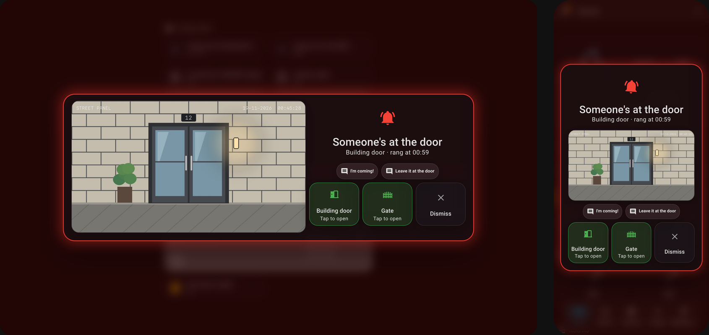
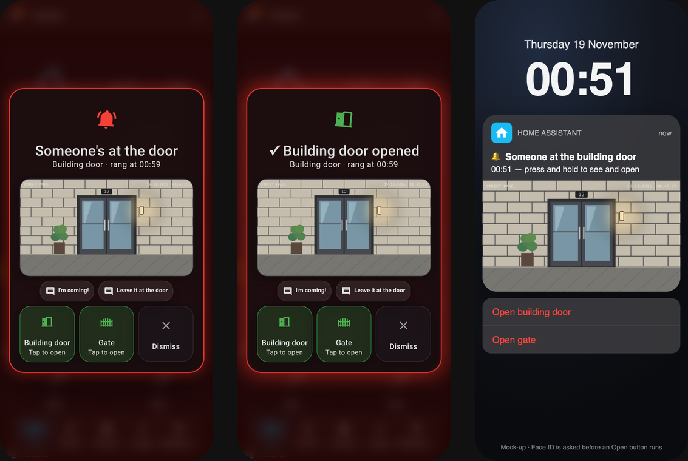
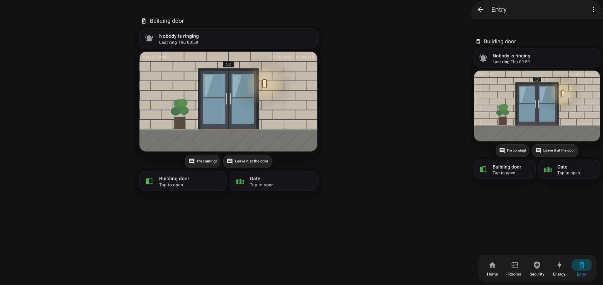

# Entry: doorbell, intercom, door and gate

When someone rings, every screen running the kit's dashboards shows who is there and lets you open the door. Your phones get the same, with Face ID before anything opens. It works with anything Home Assistant can see ring and anything it can open: a video doorbell, the building intercom, a gate, a barrier.



<sub>Sample home: Home Assistant's demo devices with a drawn camera picture. No real place or person.</sub>

> **Status:** new. Tested in the sample home (Home Assistant 2026.2.3) and by automated scenario tests (ring, open, timeouts, phone buttons, relay pulse, lock *open* vs *unlock*), **not yet with a real doorbell or intercom**. Reports from real setups are very welcome.

## What happens

| When | What you see |
|---|---|
| **Someone rings** | A pop-up covers whatever page is open on the tablet and the phone dashboard: live camera, *Building door* / *Gate* buttons, *Dismiss*. The attention strip says 🔔 *Someone at the building door*. The phones get a time-sensitive notification with a snapshot. |
| **You tap a door** | It asks "Open the building door?" first. Then the command goes out and the pop-up says what is actually known, for a few seconds (so you can watch them come in), then closes by itself: **✓ Building door opened** only when the door's `confirm` sensor changed to open after the tap, **🔓 unlocked** when only a lock confirms, **opening…** for a gate still moving, and **Open sent to Building door** when nothing confirms it (no sensor, or it already showed open). The phones' notification turns into the same quiet line, e.g. "✅ Building door opened at 00:51". |
| **You press Open on the phone** | iPhone asks for Face ID or the passcode, then the same as above. |
| **Nobody answers** | After the ring time (90 s by default) the pop-up closes. The phone notification stays, so you can see you missed someone. |
| **Quick replies** (optional) | "I'm coming!", "Leave it at the door"… spoken through the doorbell's speaker. |
| **Talk** (optional) | Two-way audio in the pop-up, if your device supports it (see [Talking back](#talking-back)). |



<sub>Left and middle: the phone dashboard in the sample home. Right: a mock-up of the iPhone notification. The notification's content is what the blueprint sends, but the picture is drawn, not a phone screenshot.</sub>

There is also an **Entry** page (tab bar on the phone, tabs on the tablet) with the camera, the last ring and the open buttons, any time:



## Hardware: what works

Anything that shows up in Home Assistant works. The kit needs three things from your hardware, and each one can come from a different device:

| The kit needs | It can be | Examples |
|---|---|---|
| **Something that rings** | a doorbell **event** entity (`event.…`), a doorbell **binary sensor**, or a **button** | Video doorbells with a Home Assistant integration (UniFi Protect, Reolink, DoorBird and others) expose a doorbell event or sensor. A building intercom can give one through its integration, or through a sensor on its call signal. |
| **Something that opens** | a **lock** (*open* is used if it supports it, for electric strikes), a **button**, a **switch** pulsed on and off (a relay), or a **cover** (gate, barrier, garage) | An intercom integration's door-open button, an electric strike, a relay on the intercom's door-release contact, a gate motor's controller |
| **A camera** (optional) | any `camera.…` | The doorbell's own camera, a camera above the entrance |

**Building intercoms (Fermax, BTicino, Comelit and others).** Most flat handsets talk to the street panel over the building's 2-wire bus, so there is rarely one integration for every model:

- Some systems have community integrations: for example a Fermax Blue integration and a BTicino Classe 300X project. They give a ring signal, a picture or video, and door opening. Check that your exact model is supported before you buy anything.
- Where there is no integration, a common approach is a small relay (for example a Shelly) on the handset's door-release contact, and a sensor on its ring signal. Then `opener` is the relay `switch`, with a 1–3 s pulse.
- **The intercom belongs to the building.** Ask the building management or an installer before you open the handset or connect anything to the bus.

**One automation per entrance.** The building panel and your own front door can share one (list both under *What rings*), or each can have its own with its own camera and buttons.

## Set it up

1. **Create the helpers** (*Settings → Devices & services → Helpers*):
   - a **Toggle** *Entry ringing*,
   - a **Date and time** helper *Entry last ring* (date and time) — recommended.
2. **One script per door or gate** from the **Entry — open a door** blueprint: [](https://my.home-assistant.io/redirect/blueprint_import/?blueprint_url=https%3A%2F%2Fgithub.com%2Fdavidteles%2Fha-wall-panel-kit%2Fblob%2Fmain%2Fblueprints%2Fscript%2Fentry%2Fentry_open.yaml)
   Name the script after the door (*Building door*, *Gate*): buttons and notifications use that name.
3. **The ring automation** from **Entry — someone rang**: [](https://my.home-assistant.io/redirect/blueprint_import/?blueprint_url=https%3A%2F%2Fgithub.com%2Fdavidteles%2Fha-wall-panel-kit%2Fblob%2Fmain%2Fblueprints%2Fautomation%2Fentry%2Fentry_ring.yaml)
   Pick what rings, the toggle, the door scripts (in button order), the camera and your phones.
4. **Add `entry:` to `my_home.yaml`** and run `python tools/render.py` again:

```yaml
entry:
  name: Building door
  ringing: input_boolean.entry_ringing
  last_ring: input_datetime.entry_last_ring     # optional
  camera: camera.street_panel                   # optional
  doors:
    - name: Building door
      open: script.open_building_door
      confirm: binary_sensor.building_door      # optional: a contact, lock or cover that proves it opened (use the same one as in the door script)
    - name: Gate
      icon: mdi:gate
      open: script.open_gate
  # Everything below is optional
  popup: card                                   # card (default) | browser_mod | none
  talk_stream: street_panel                     # go2rtc stream with a back-channel: two-way talk
  speaker: media_player.street_panel_speaker    # quick replies through this speaker…
  tts: tts.home_assistant_cloud                 # …with this text-to-speech
  replies: ["I'm coming!", "Leave it at the door"]
```

5. **Test it without anyone at the door:** add a **Button** helper *Doorbell (test)* under *What rings* and press it. To try the open buttons without opening anything, make a door script whose opener is another Button helper.

## The pop-up: two kinds, use one or both

| | **Built in** (`popup: card`, the default) | **browser_mod** (in the ring automation) |
|---|---|---|
| Needs | [card-mod](https://github.com/thomasloven/lovelace-card-mod) | [browser_mod](https://github.com/thomasloven/hass-browser_mod), and each screen registered as a browser |
| Shows on | every page of the kit's tablet and phone dashboards | any dashboard on the screens you list (or "all") |
| Opens and closes | follows the *Entry ringing* toggle | the automation opens and closes it |

They can work together. For example, use the built-in one on the wall tablet and browser_mod on a computer or a TV that shows another dashboard. Don't list a screen in browser_mod if it also shows the kit's dashboard, or it gets two pop-ups. With `popup: browser_mod` or `none`, Home shows a red *Someone at the building door* card instead, and tapping it goes to the Entry page.

The pop-up adapts itself:
- **Buttons:** one per door plus *Dismiss*, so one door gives two wide buttons and two doors give three.
- **Layout:** in landscape on a tablet, the camera is on the left and the buttons on the right. On a phone, everything is stacked.

## Talking back

There are three levels, depending on the device:

1. **Two-way talk in the pop-up.** Set `talk_stream` to a [go2rtc](https://github.com/AlexxIT/go2rtc) stream that has a back-channel (microphone) source for your device, and install the [WebRTC Camera](https://github.com/AlexxIT/WebRTC) card. The pop-up and the Entry page then show it with the microphone on.
   - Which doorbells support this depends on the model and on go2rtc. Check go2rtc's list of two-way audio sources for yours.
   - **Browsers only allow the microphone over HTTPS**, so the tablet must open Home Assistant over `https://`.
2. **Quick replies.** If the doorbell has a speaker that Home Assistant can play to (a `media_player`), list a few `replies`. Each one becomes a button that speaks through the doorbell.
3. **The maker's app.** Some systems only talk through their own app; tapping the phone notification can still bring you to the Entry page to open the door.

## Security

- **Every Open button asks first:** a confirmation on dashboards, Face ID or the passcode on iPhone notifications (`authenticationRequired`). That option is for iPhone. Check the Android companion app's documentation for what your phone does before you rely on it there.
- **Wall tablets inside the flat only.** Don't put a dashboard with Open buttons on a screen that people outside can reach.
- **Voice assistants:** don't expose the door scripts to Assist or other voice assistants unless they ask for a PIN.
- Opening is logged: every open fires the event `wall_panel_entry_opened` (door name and entity), and the script run shows in the logbook.

## Options

**Ring automation** (*Entry — someone rang*):

| Input | Default | What it does |
|---|---|---|
| Name | Door | "Someone at the *building door*" |
| What rings | — | Event, binary sensor or button entities (several are fine). For event entities that have a *ring* type, only *ring* counts. |
| "Entry ringing" toggle | — | On while ringing; the dashboards follow it |
| "Entry last ring" | — | Keeps "last ring Thu 18:20" right after restarts |
| Door scripts | — | The *Entry — open a door* scripts, in button order |
| Camera | — | Snapshot on the phones; the pop-up's camera with browser_mod |
| go2rtc stream | — | Two-way talk in the browser_mod pop-up |
| Keep ringing for | 90 s | Then the pop-up closes |
| After opening, close the pop-up after | 10 s | Time to watch them come in |
| browser_mod browsers | — | Browser IDs separated by commas, or `all` |
| Phones / Notification action | — | Companion-app phones, or one notify action (e.g. a group) |
| Page to open from the notification | /phone-home/entry | Where tapping the notification goes |

**Open script** (*Entry — open a door*): name, what opens it (lock, button, switch, cover) and the relay pulse for switches (2 s).

## Troubleshooting

- **The ring isn't noticed.** Look at the entity in *Developer tools → States* while someone rings.
  - An `event.…` entity should get a new time, with `event_type: ring`.
  - A binary sensor should go from `off` to `on`.
  - Coming back from *unavailable* is ignored on purpose.
- **No pop-up on the tablet.** Check that card-mod is installed and that *Entry ringing* turns on. With browser_mod, the browser IDs can change after a browser update: check them in the Browser Mod panel in the sidebar.
- **No picture in the phone notification.** The phone fetches the snapshot from Home Assistant, so it needs to reach Home Assistant from where it is.
- **Talk: you hear them but they don't hear you.** The page isn't on HTTPS, or the go2rtc stream has no back-channel for your device.

## Remove it

Delete the ring automation and the door scripts, then the two blueprints, the helpers, and the `entry:` section in `my_home.yaml` (run the generator again).
