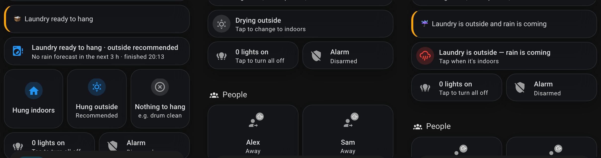

# Laundry: ready to hang, where it's drying, rain

When the wash is done, Home says so with the drying advice and three buttons. Once it's on the rack, it shows where it's drying, and it turns red if rain is coming while the laundry is outside.



<sub>Sample home: Home Assistant's demo devices, made-up people. No real place.</sub>

> **Status:** new. Tested in the sample home and by the generator tests, **not yet with a real wash**.

## What you see

| When | On Home |
|---|---|
| **Wash done** | "Laundry ready to hang · outside recommended", with the reason and the finish time. Then **Hung indoors**, **Hung outside** and **Nothing to hang** (with a confirmation). The recommended one says *Recommended*. The attention strip says 🧺 *Laundry ready to hang*. |
| **On the rack, nobody chose** | "Laundry on the rack — where is it drying?" with **Indoors** / **Outside** |
| **Drying** | "Drying outside · tap to change to indoors", with a confirmation |
| **Rain is coming while it's outside** | A red card "Laundry is outside — rain is coming · tap when it's indoors". The strip says ☔ *Laundry is outside and rain is coming*. |

The buttons have no entity, so tapping an icon does exactly what tapping the card does.

## What it needs

The cards follow helpers that blueprints in [ha-blueprints](https://github.com/davidteles/ha-blueprints#laundry) keep up to date:

| Key in `my_home.yaml` | Helper | Kept up to date by |
|---|---|---|
| `waiting` (required) | Toggle "Laundry waiting" | **Laundry done** |
| `finished_at` | Date and time "Washer finished at" | **Laundry done** |
| `advice` | Text "Laundry drying advice" | **Laundry drying advice** |
| `place` + `script` | Dropdown "Laundry drying place" (*Not set*, *Indoors*, *Outside*, *Not hung*) and a script from **Laundry hung** | the **Laundry hung** script, and the **Laundry done** phone buttons |
| `on_rack` | Toggle "Laundry on the drying rack" | **Drying-rack reminder** |
| `rain_alert` | Toggle "Laundry rain alert" | **Drying-rack reminder** |

Only `waiting` is required. With `waiting` alone, Home shows one "tap when it's out of the machine" card.

```yaml
laundry:
  waiting: input_boolean.laundry_waiting
  finished_at: input_datetime.washer_finished_at
  advice: input_text.laundry_drying_advice
  place: input_select.laundry_drying_place
  script: script.laundry_hung
  on_rack: input_boolean.laundry_on_drying_rack
  rain_alert: input_boolean.laundry_rain_alert
```

## How it fits together

1. **Laundry done** turns *waiting* on when the cycle finishes. With the dropdown set, its phone notification has the same three buttons.
2. **Laundry drying advice** writes the recommendation. It's advice only: nothing is decided for you.
3. A button (here or on the phone) sets *where* and turns *waiting* off.
4. **Drying-rack reminder** takes over:
   - indoors switches the dehumidifier on;
   - outside watches for rain;
   - *Not hung* (a drum clean, or a washer-dryer that dried it) puts nothing on the rack;
   - if nobody chose, it waits for a person.

## Remove it

Delete the `laundry:` section, run the generator again and paste the new dashboards. The blueprints and helpers are separate; remove them in Home Assistant if you no longer want them.
