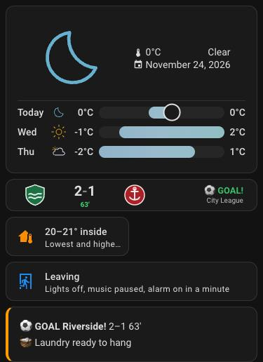

# Your team's match on the panel

A slim strip on Home while your team plays: both logos, the kick-off time before the match, then the
score with the minute under it, "● Live" / "● Half time" / "Full time" and the competition. For a few
minutes after a goal, "⚽ GOAL <team>!" is the first line of the attention strip, and the strip says
"⚽ GOAL!" too. Outside the match the strip is gone, so it costs no room on a page that must fit.



It reads the [Team Tracker](https://github.com/vasqued2/ha-teamtracker) integration (Marketplace /
HACS), which gives one sensor per team with the state `PRE`, `IN`, `POST` or `NOT_FOUND` and the
ESPN details as attributes (`date`, `clock`, scores, names, logos). It works for any sport Team
Tracker covers; the wording ("Kick-off", "Half time") is football's.

## 1. Helpers

Settings → Devices & services → Helpers → Create helper:

| Helper | Type | Used for |
|---|---|---|
| `input_datetime.match_ended_at` | Date and time | when the last match ended (survives restarts) |
| `input_datetime.last_goal_at` | Date and time | optional — when the last goal went in |
| `input_text.last_goal_by` | Text | optional — which team scored it |

## 2. The blueprint that fills them

Import **Team Tracker match memory** from
[ha-blueprints](https://github.com/davidteles/ha-blueprints) (`blueprints/automation/sports/`) and pick
your Team Tracker sensor and the helpers above. It saves the final-whistle time (`IN` → `POST`) and,
for each goal during a live match, who scored and when. A goal that is taken back (the score goes
down) clears it. Restarts and the next match never count as a goal.

## 3. Two template helpers (the rules, in one place each)

Create helper → Template → **Binary sensor**. Replace `sensor.my_team` and the helper names.

**Match window** (`binary_sensor.match_window`): on from 30 minutes before kick-off, during the
match (half time included) and for one hour after the end.

```jinja




true
{{ now() >= k - timedelta(minutes=30) }}
{{ now() < end + timedelta(hours=1) }}
false
```

The end time comes from the helper, never from `last_changed`, which resets when Home Assistant
restarts. If Home Assistant was down at the final whistle, it falls back to kick-off + 115 minutes.

**Goal alert** (`binary_sensor.goal_alert`, optional): on for 5 minutes after a goal, while live.

```jinja


{{ is_state('sensor.my_team', 'IN') and gts is number and gby not in ['', 'unknown', 'unavailable']
   and (now().timestamp() - gts) < 300 }}
```

Use the same window sensor anywhere else that should follow the match (a screensaver line, a
second card), so the rule lives in one place.

## 4. my_home.yaml

```yaml
match:
  sensor: sensor.my_team
  window: binary_sensor.match_window
  goal_alert: binary_sensor.goal_alert   # optional, with goal_by
  goal_by: input_text.last_goal_by
```

Run `python tools/render.py` again. The strip sits under the clock and weather card and is 56 px
tall, the same as the other alert cards, so a page that fits today still fits during a match
(measure your own tablet if its Home page is already full).

## Remove it

Delete the `match:` block and render again; then delete the helpers and the blueprint automation.
